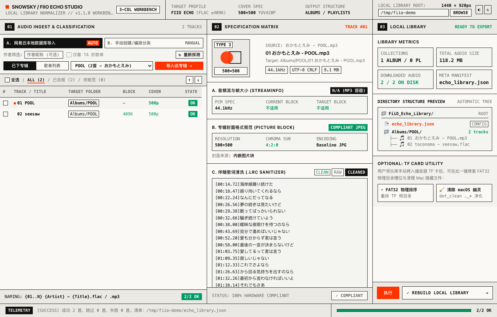

# FIIO ECHO STUDIO
### 飞傲便携无损播放器专用乐库规范化工作台

<div align="center">

[](https://github.com/KaiTeeDreamChai/fiio-echo-studio)
[](https://github.com/KaiTeeDreamChai/fiio-echo-studio)
[](https://github.com/KaiTeeDreamChai/fiio-echo-studio)
[](LICENSE)

</div>

---

<!-- USER_TODO: 在此处放置应用主界面运行截图或 GIF 演示动图 -->
<!--
<div align="center">
  
</div>
-->

---

## 01 // OVERVIEW

这是一套专为 **飞傲（FiiO）/ SNOWSKY 便携无损音乐播放器**（如 FiiO Echo 及同架构硬件）深度定制的跨平台乐库管理工作台。

便携硬件播放器受限于嵌入式解码芯片算力、DMA 缓冲区大小与 FAT32 文件系统寻址机制，直接拷入未经处理的现代流媒体音频或高规格曲目常导致 **切歌爆音、死机卡顿、封面无法渲染、乱码及按物理扇区乱序播放**。

本工作台遵循 **Swiss International Typographic Style** 设计构建。

### 核心设计原则
* **严谨硬件合规 (Hardware Exactness)**：所有重构均面向硬件解码器的物理约束，绝不进行劣质重采样。
* **无损与元数据完整 (Bit-Exact Integrity)**：仅规整 FLAC 元数据容器与 Frame BlockSize，100% 保持 16/24-bit PCM 音频无损。
* **信息高密度与纯粹排版 (Swiss Typographic UI)**：无浮夸装饰，采用严谨的网格系统、非对称信息排布与等宽数据检视。

---

## 02 // HARDWARE SPECIFICATION (硬件解码与存储规格)

工作台流水线自动执行以下五维硬件合规校验与物理重整：

| # | 检视维度 (DIMENSION) | 硬件严苛指标 (HARDWARE TARGET) | 自动化流水线处理机制 (AUTO-PIPELINE) | 状态 |
|---|---|---|---|:---:|
| **01** | **FLAC 帧块大小** | `BlockSize ≤ 4096` (4KB DMA 限制) | 探测 `STREAMINFO`，对 `> 4096` 重新封装帧块，修正格式错误和播放异常 | `ENFORCED` |
| **02** | **内嵌封面渲染** | `500 × 500` Baseline JPEG (`YUV 4:2:0`) | 强制等比缩放、去除渐进式编码、清理多余 Picture 块仅保留单一 Front 封面 | `ENFORCED` |
| **03** | **同名同步歌词** | 严格同名 `.lrc`，`[mm:ss.xx]` 格式，`UTF-8 CRLF` | 自动清洗网易云 `{"t":...}` 脏词、去除毫秒三位尾缀、强制 CRLF 换行 | `ENFORCED` |
| **04** | **网易加密解密** | 原生 `16/24-bit` 无损还原 | 原生 AES-128 / RC4 解密 `.ncm` 容器，提取内嵌 ID3/Vorbis 元数据 | `ENFORCED` |
| **05** | **FAT32 物理槽位** | 目录项物理连续排序 (`01..N`) | 物理重排 FAT32 目录槽位并执行 macOS `._*` 幽灵文件净化 (`dot_clean`) | `ENFORCED` |

---

## 03 // WORKBENCH ARCHITECTURE (工作台架构)

### 三栏工作台功能设计
* **COL 01: 乐库与队列检视**：网易云本地专辑/歌单双模态、歌单筛选（可选）、已下载感知（X/Y OK）、自定义目标目录归档与物理上下排序。
* **COL 02: 硬件规范深度透视**：实时音频解码参数监测、FLAC BlockSize 诊断（≤4096）、500×500 YUV 4:2:0 封面校验、同步 LRC 清洗实时对比。
* **COL 03: 规范构建与输出**：目标路径挂载、流水线执行进度、FAT32 物理槽位顺次重排与 macOS 幽灵文件净化。

### 技术栈构成 (Tech Stack)
* **GUI 工作台**：React 19 + TypeScript + Tailwind CSS (瑞士国际设计系统，深浅双主题即时切换)
* **桌面原生桥接**：Python 3 + Cocoa `pywebview` (原生 macOS WKWebView 零额外框架负担)
* **音频与元数据引擎**：`mutagen` + 内嵌静态单文件 `ffmpeg` (7.x 静态构建) + 原生 `ncmdump`
* **独立桌面打包**：PyInstaller 6.x + Apple Developer Command Line Tools + `hdiutil` 自动化 DMG 构建

---

## 04 // INSTALLATION & DOWNLOAD

### 方式 A: 预编译安装包 (推荐)
<!-- USER_TODO: 在此处填入 Release 版本的下载直链或百度网盘/GitHub Release 地址 -->
1. 从 [Releases](../../releases) 页面下载最新版 DMG 安装包：
   * `FiiO_Echo_Studio_v1.0.0_arm64.dmg` (适用于 Apple Silicon)
2. 双击打开 DMG，将 **FiiO Echo Studio** 拖入 **Applications (应用程序)** 目录即可。
3. 首次使用无需安装任何外部依赖（`ffmpeg`、`ncmdump` 及 Python 运行环境均已全内置静态封装）。

### 方式 B: 从源码运行与开发构建

```bash
# 1. 克隆本仓库
git clone https://github.com/KaiTeeDreamChai/fiio-echo-studio.git
cd fiio-echo-studio

# 2. 安装前端依赖
npm install

# 3. 运行前端开发预览
npm run dev

# 4. 一键打包 macOS 独立桌面 App 及 DMG 安装包
chmod +x build_app.sh
./build_app.sh
```

构建完成后产物将输出至：
* `dist_app/FiiO Echo Studio.app` (独立 macOS App Bundle)
* `dist_app/FiiO_Echo_Studio_v1.0.0_arm64.dmg` (包含 Applications 软链接的标准磁盘映像)

---

## 05 // USAGE WORKFLOW

```text
[ 网易云音乐本地下载 ] 
        │
        ▼
[ 1. 扫描与检索 ] ──► 自动识别本地已下载专辑或歌单 (作者筛选可选)
        │
        ▼
[ 2. 硬件合规审计 ] ──► 检视 FLAC 块大小、封面 YUV420p、LRC 时间戳规范
        │
        ▼
[ 3. 分类与排序 ] ──► 调整目标目录 (Albums / Playlists) 与播放物理顺次
        │
        ▼
[ 4. 规范化构建 ] ──► 一键执行 NCM 解密 ➔ FLAC 重封装 ➔ 封面转码 ➔ 歌词生成
        │
        ▼
[ 5. 存储介质净化 ] ──► FAT32 目录项物理槽位重排 ➔ macOS 幽灵文件清除
        │
        ▼
[ 插入 FiiO 播放器开机即播，无任何卡顿爆音 ]
```

---

## 06 // PROJECT ROADMAP (项目演进路线)

- [x] 瑞士国际主义风格高对比 UI 与深浅色自适应模式
- [x] 网易云音乐本地 SQLite 库只读检索与多专辑/歌单聚合
- [x] FLAC BlockSize 探测与降级至 4096 物理帧
- [x] 封面 Baseline JPEG 500x500 YUV 4:2:0 色度抽样合规化
- [x] 同名 LRC 同步清洗（UTF-8 CRLF 格式）
- [x] FAT32 物理槽位排序与 macOS `dot_clean` 净化
- [x] macOS 原生单文件 App 与 DMG 打包流水线
- [ ] 添加 Windows / Android / Linux 等平台支持
- [ ] 添加多配置文件支持，以适配更多播放器（ Shanling、HiBy、Sony Walkman 等）


---

## 07 // CONTRIBUTING & LICENSE (开源协议)

欢迎提交 Issue 与 Pull Request 共同完善对更多硬件播放器（如 Shanling、HiBy、Sony Walkman 等）的特殊音频与文件系统适配。

本项目采用 [WTFPL](LICENSE) 开源许可证，因使用本软件所造成的任何数据丢失、硬件损坏或异常损失概不负责。

---

<div align="center">
  <sub>CRAFTED WITH PRECISION FOR AUDIOPHILES & PORTABLE DAPS</sub><br>
  <sub>DESIGNED IN SWISS INTERNATIONAL TYPOGRAPHIC STYLE</sub>
</div>
