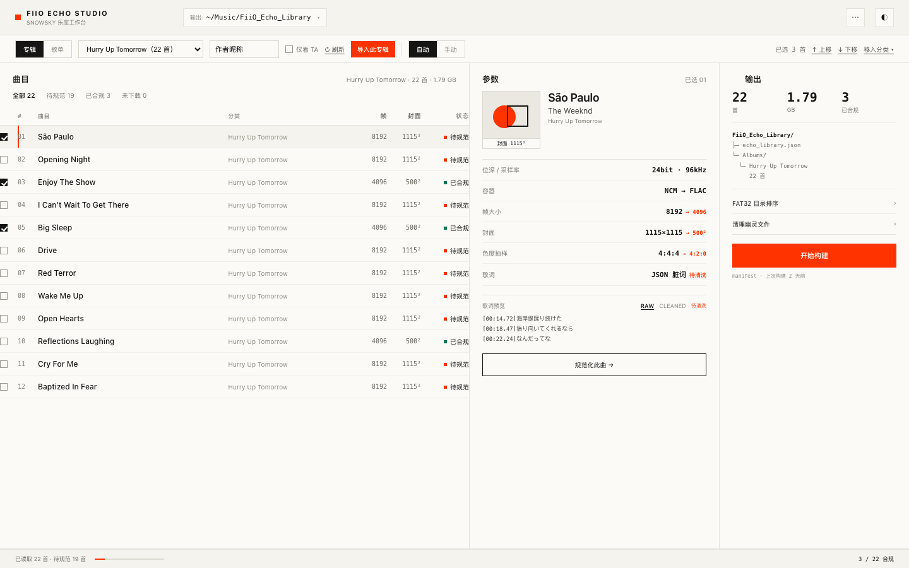
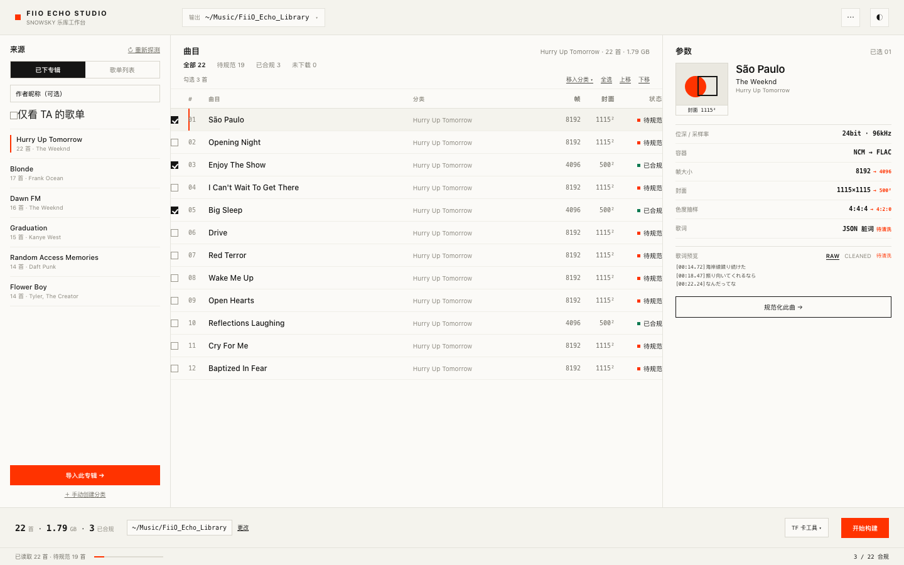
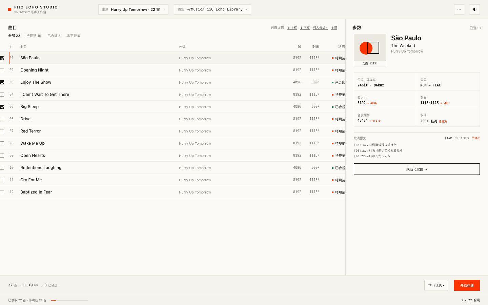
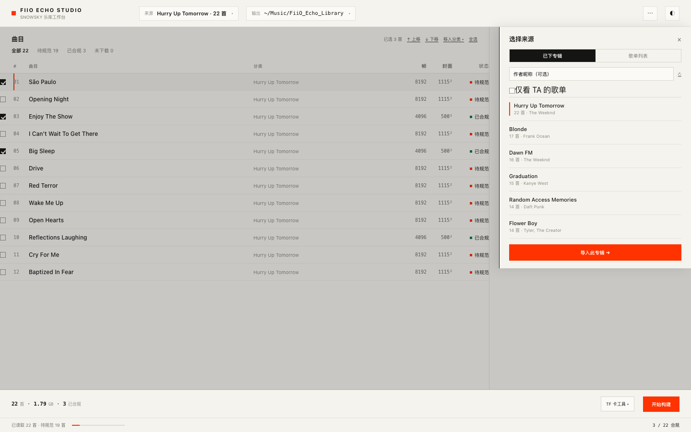

# 桌面主界面减噪方案（功能不删）

> **状态（2026-10-30）：B 方案已实现。** 桌面端现在是「来源侧栏 + 曲目 + 参数 + 底部构建栏」；
> 侧栏支持专辑/歌单切换、**模糊搜索**、作者/歌手模糊筛选、重新探测、导入、手动创建分类。
> 实现截图：`docs/assets/desktop-b-implemented.png`、`desktop-b-search.png`、`desktop-b-user-filter.png`。

> 原则：**功能一个不删，只改变"放在哪里"和"说几遍"**。
> 三套样例都包含：来源选择、作者筛选、重新探测、导入、输出目录、手动分类、多选/全选、上下移、帧/封面/状态、参数详情、歌词 RAW/CLEANED、单曲规范化、输出统计、TF 工具、构建与进度、主题/设置。
>
> 截图：`docs/assets/redesign-a.png`、`redesign-b.png`、`redesign-c.png`、`redesign-c-open.png`

---

## 1. 现状问题：不是信息多，是同一条信息说了三遍

| 重复项 | 现状 |
|---|---|
| 目录 | 页头输入框 + 表格 `TARGET FOLDER` 列（22 行）+ 输出面板路径 |
| 曲目数 | 表格页脚 `22 TRACKS` + 筛选行 `ALL (22)` + 输出面板指标 + 底部页脚 |
| 合规数 | 队列表页脚 + 输出面板 + 底部页脚 |
| 模式 | `A. 网易云…AUTO` + 状态徽章 + 说明文字 |
| 命名规则 | 队列表底部 `NAMING:…`（纯说明） |
| 状态 | 表格状态列 + 右侧 `STATUS:` 长句 + 按钮文案 |

所以减噪的第一步不是缩小字号，而是**把重复项收敛到一处**，再把剩下的控件按"每次都要用 / 偶尔用"分层。

---

## 2. 三套方案

### A · 双行工具条（改动最小）

- 页头只保留：品牌、输出目录、设置/主题。
- 来源、专辑选择、作者筛选、刷新、导入、自动/手动、选中操作全部收进**第二条工具条**。
- 主区仍是三栏（曲目 / 参数 / 输出），去掉了 `TARGET FOLDER` 重复列之外的冗余标签，保留帧、封面、状态三列。
- 功能全部常驻可见，只是从"散落在 3 个面板"变成"一条任务栏"。

**适合**：想以最小风险先改善观感，布局骨架不变。

### B · 来源侧栏（推荐）

- 把"来源浏览"从第一栏顶部拆出来，变成独立的左侧栏：专辑/歌单切换、作者筛选、重新探测、专辑列表、导入、手动创建分类。
- 中间只放曲目表（空间更大），右侧参数，底部一条**构建栏**承载统计、输出目录、TF 工具、开始构建。
- 原来的"三栏"变成"侧栏 + 主表 + 参数 + 底部栏"，每个区域只做一件事，重复信息自然消失。

**适合**：作为主力方案；功能全部直接可见，密度最低且不需要额外点击。

### C · 抽屉式（最干净，多一次点击）

- 默认界面只有：页头（来源/输出/设置）、曲目表、参数、底部构建栏。
- 点页头的"来源"才滑出右侧面板：专辑/歌单切换、作者筛选、刷新、专辑列表、导入。
- 导入、换目录属于低频操作，收起来后主界面最安静。

**适合**：喜欢极简、能接受"导入时多一次点击"；也适合未来手机端复用这套结构。

---

## 3. 已实现的模糊搜索

搜索是本地匹配（数据已在前端，281 张专辑 / 411 个歌单，毫秒级），规则在 `src/lib/fuzzy.ts`：

1. **归一化**：Unicode NFKC + 转小写 + 去掉空格、连字符、标点（`·`、`-`、`《》` 等）。
2. **三级命中**：
   - 完全相等（1000 分）
   - 前缀匹配（900 分）
   - 连续子串（800 分，越靠前越高）
   - 子序列兜底（400 分）：`hurrytom` 能命中 `Hurry Up Tomorrow`，`weeknd` 能命中 `The Weeknd`
3. **多字段加权**：名称权重 1.0，作者/歌手 0.7，取最高分；结果按分数排序。
4. **两处入口**：
   - 主搜索框：专辑模式匹配「专辑名 + 歌手」，歌单模式匹配「歌单名 + 作者」。
   - 作者/歌手框：对候选做模糊建议（下拉最多 8 个），选中后按该值筛选列表。
5. **用户（创建人）筛选**：
   - 歌单模式下，作者框就是“按创建人搜索”，输入即实时筛选（不需要先点候选）。
   - 结果按 **歌单创建时间倒序** 排列，每行显示 `曲目数 · 创建人 · YYYY-MM-DD`。
   - 下拉候选按匹配度/歌单数量排序，回车选中第一个，`×` 清空。
   - 例：输入 `Dream_Chai` → 260 / 412 个歌单，首条是 `2026-10-05《实验》`。
6. **“我创建 / 我收藏”切换**：
   - 歌单模式下提供 `全部 412 / 我创建 260 / 我收藏 45` 三个文字标签。
   - 归属由后端判定：当前账号来自 `page:userDetail`（uid + 昵称）；`relation=created` 取 `createPlaylist` 集合或 `creator_id == 当前 uid`；`relation=favorited` 取 `favPlaylist` 集合；其余为 `cached`。
   - 两个标签都按歌单创建时间倒序；本地库没有“收藏时间”字段，因此我收藏也按歌单原始创建时间排序。
   - 截图：`docs/assets/desktop-b-created.png`、`desktop-b-favorited.png`。
7. **交互细节**：命中词标红加粗、`×` 一键清空、空结果给“清除筛选”、切换专辑/歌单时自动清空搜索与作者条件、双击列表项直接导入。

## 4. 功能对照表（三套都齐全）

| 功能 | A 工具条 | B 侧栏 | C 抽屉 |
|---|---|---|---|
| 专辑 / 歌单切换 | 工具条分段 | 侧栏分段 | 来源面板分段 |
| 作者筛选 + 仅看 TA | 工具条输入框 | 侧栏输入框 | 来源面板输入框 |
| 重新探测 | 工具条 ↻ | 侧栏"重新探测" | 来源面板 ↻ |
| 选择专辑 | 下拉框 | 侧栏列表 | 来源面板列表 |
| 导入此专辑 | 工具条按钮 | 侧栏底部按钮 | 面板底部按钮 |
| 选择输出目录 | 页头目录 chip | 构建栏路径 + 更改 | 页头目录 chip |
| 手动分类 | 自动/手动 + 移入分类 | 手动创建 + 移入分类 | 移入分类 |
| 多选 / 全选 | 表格勾选 + 已选 | 表格勾选 + 全选 | 表格勾选 + 全选 |
| 上移 / 下移 | 工具条 | 表格工具条 | 表格工具条 |
| 帧 / 封面 / 状态 | 表格列 | 表格列 | 表格列 |
| 参数详情 | 中栏 | 右栏 | 右栏 |
| 歌词 RAW/CLEANED | 中栏 | 右栏 | 右栏 |
| 单曲规范化 | 中栏按钮 | 右栏按钮 | 右栏按钮 |
| 输出统计 / 结构 | 右栏 | 底部构建栏 | 底部构建栏 |
| FAT32 / dot_clean | 右栏工具列表 | 构建栏"TF 卡工具" | 构建栏"工具" |
| 构建 / 进度 | 右栏按钮 + 页脚 | 构建栏 + 页脚 | 构建栏 + 页脚 |
| 主题 / 设置 / 重置 | 页头图标 | 页头图标 | 页头图标 |

---

## 5. 三套共用规则

1. **一个信息只说一次**：目录、曲目数、合规数各只出现一处。
2. **中文标签，英文只做单位/品牌**：不再出现"音频流与帧大小 (FLAC STREAMINFO)"。
3. **字阶收敛到 4 级**：10/11、13/14、20/22、26/28。
4. **颜色克制**：橙色只给"待处理 + 主操作"，绿色只给"已合规"。
5. **用线不用框**：分组靠 1px 分隔线与留白，不给每个控件套边框。
6. **数字等宽右对齐，标题左对齐**；行高 44–48，栏内边距 24–28。
7. **低频操作分层**：来源/目录/工具可以收进侧栏或面板，但永远一键可达。

---

## 6. 建议

- **主推 B**：功能全可见、不重复、主表最宽，是"减密度但不减功能"最平衡的形态。
- **最低风险选 A**：不动三栏骨架，只加一条工具条，1–2 天可完成。
- **C 作为补充**：如果以后要复用到手机/平板，抽屉式结构最好迁移。

也可以分两步：先做 A（快速收敛重复信息），稳定后再演进到 B（把来源拆成侧栏）。

---

## 7. 实施映射

| 现文件 | A | B | C |
|---|---|---|---|
| `SwissHeader.tsx` | 精简为品牌/目录/设置 | 品牌/目录/设置 | 品牌/来源/目录/设置 |
| `QueuePanel.tsx` | 来源控件上移到工具条 | 来源控件拆成 `SourceSidebar` | 来源控件进 `SourceSheet` |
| `InspectorPanel.tsx` | 去编号/英文括注 | 同左 | 同左 |
| `LocalLibraryPanel.tsx` | 保留右栏 | 改为底部 `BuildBar` | 改为底部 `BuildBar` |
| `TelemetryFooter.tsx` | 单行日志 + 进度 | 同左 | 同左 |
| `src/index.css` | 字号/间距/状态色变量 | 同左 + 侧栏样式 | 同左 + 面板/遮罩样式 |

工作量：A 约 1–2 天；B 约 3–4 天（拆组件）；C 约 2–3 天（弹层 + 状态管理）。

---

## 8. 待确认

1. 选 A（最小改动）、B（推荐）还是 C（最干净）？
2. 来源侧栏/抽屉里的专辑列表，要不要顺带加"搜索专辑"？（当前网易云库 281 张，列表滚动已经很吃力）
3. 底部构建栏是否接受替代原来的"第三栏输出面板"？
